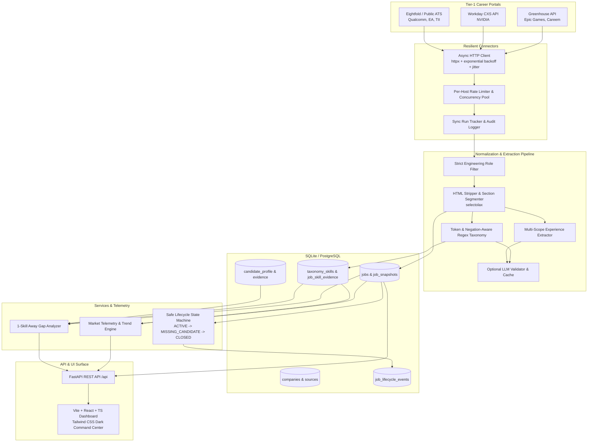
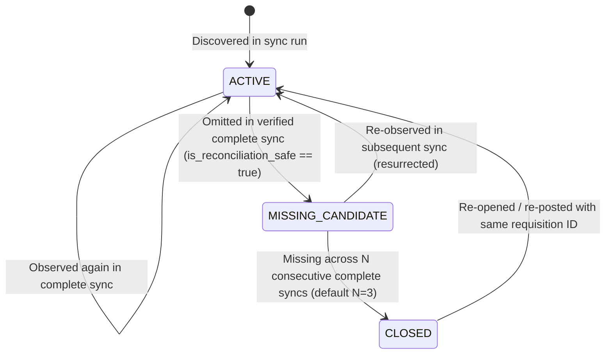

# DevRadar Architecture Blueprint

DevRadar is a production-grade, automated Engineering Job Radar, Evidence-Based Skill Extractor, and Market Telemetry Engine designed to ingest open positions across Tier-1 tech organizations, extract verified technical skills with cited sentence evidence, safely reconcile job lifecycles without data loss, and deliver real-time market analytics and candidate gap analysis.

---

## 1. High-Level System Architecture

---

## 2. Normalized Relational Schema (`backend/db/`)

The database is built on SQLAlchemy 2.0 with strict foreign keys, indexes, and full compatibility across SQLite and PostgreSQL.

### Key Entities:
1. **`companies` & `sources`**:
   - `company_id`: String primary key (e.g. `nvidia`, `epicgames`).
   - `provider_type`: `workday`, `greenhouse`, `eightfold`.
   - `base_url`, `board_token`, `endpoint`.
   - `polling_interval_minutes`, `concurrency_limit`, `timeout_seconds`.
   - `health_status` (`HEALTHY`, `DEGRADED`, `OFFLINE`).
   - `last_successful_sync`, `last_attempted_sync`, `last_error`.
   - Allowed host whitelisting to safeguard against SSRF.

2. **`sync_runs`**:
   - `run_id`: UUID string.
   - `source_id`: FK to `sources.source_id`.
   - `started_at`, `completed_at`, `duration_ms`.
   - `run_status`: `COMPLETE`, `PARTIAL`, `RATE_LIMITED`, `ACCESS_DENIED`, `NETWORK_ERROR`, `SCHEMA_ERROR`.
   - `pagination_complete`: Boolean flag indicating if crawler exhausted all pages.
   - `jobs_discovered`, `jobs_created`, `jobs_updated`, `jobs_unchanged`, `jobs_rejected`.
   - `is_reconciliation_safe`: Boolean guard. True ONLY when `run_status == COMPLETE` AND `pagination_complete == True` AND discovered count >= threshold.

3. **`jobs`**:
   - `job_id`: Generated deterministic composite key `(source_id:provider_posting_id)`.
   - `source_id`, `provider_posting_id`, `requisition_id`.
   - `title`, `canonical_category` (`Silicon & AI`, `Game Studio`, `UAE & Middle East`, `Systems & Infra`).
   - `department`, `location`, `work_arrangement` (`remote`, `hybrid`, `onsite`, `unknown`).
   - `apply_url`, `source_url`.
   - `first_seen_at`, `last_seen_at`, `last_successfully_observed_at`.
   - `consecutive_missing_syncs`: Integer counter tracking missed syncs.
   - `lifecycle_status`: `ACTIVE`, `MISSING_CANDIDATE`, `CLOSED`.
   - `normalized_description`: Cleaned whitespace and formatted text.
   - `description_hash`: SHA256 of normalized text.

4. **`job_snapshots`**:
   - `snapshot_id`: Integer autoincrement.
   - `job_id`: FK to `jobs.job_id`.
   - `observed_at`: Timestamp.
   - `raw_payload_json`: Verbatim payload for auditability.
   - `normalized_text`: Cleaned text.
   - `description_hash`: Hash fingerprint.

5. **`job_lifecycle_events` & `job_field_change_events`**:
   - Immutable historical audit logs recording state transitions (`ACTIVE -> MISSING_CANDIDATE`) or field updates (title changes, experience modifications, salary updates).

6. **`taxonomy_skills` & `job_skill_evidence`**:
   - `skill_id`: Canonical normalized identifier (e.g. `cuda`, `cpp`, `unreal_engine`).
   - `skill_name`: Formatted display name (e.g. `CUDA`, `C++`, `Unreal Engine 5`).
   - `category`: `Languages`, `GPU / Performance`, `Game Engines`, `AI / ML`, `Deployment / Cloud`, `Systems / OS`.
   - `requirement_type`: `required`, `preferred`, `mentioned`, `uncertain`.
   - `evidence_text`: Verbatim sentence where the skill was identified in the job description.
   - `extraction_method`: `deterministic_regex` | `llm_validated`.

7. **`job_experience_requirements`**:
   - `min_years`: Integer or null.
   - `max_years`: Integer or null.
   - `experience_scope`: `overall_professional`, `skill_specific`, `degree_equivalent`, `entry_level_signal`.
   - `related_skill`: Associated skill name if scope is `skill_specific`.
   - `evidence_text`: Quoted phrase containing experience requirement.

8. **`candidate_profile` & `candidate_skill_evidence`**:
   - User's claimed and verified skills with proficiency level and evidence level (`claimed`, `coursework`, `project`, `production`).

---

## 3. Safe Job Closure State Machine

### Safety Guards:
- If a sync run encounters HTTP 429, 403, 500, network timeouts, or schema mismatches, `is_reconciliation_safe` is set to `False`.
- Missing jobs from that run are **NEVER** marked `MISSING_CANDIDATE` or `CLOSED`.
- If total discovered count drops by more than 50% relative to historical average, the run triggers an anomaly warning and skips reconciliation.

---

## 4. Hybrid Skill & Experience Extraction Pipeline

### A. Section Segmentation (`selectolax`)
HTML descriptions are stripped of `<script>`, `<style>`, and tracking tags, preserving `<h1>-<h6>`, `
`, and `<li>`. The parser scans heading semantics to segment the description into:
1. `REQUIRED_SECTION`: e.g., "What You'll Need", "Basic Qualifications", "Minimum Requirements".
2. `PREFERRED_SECTION`: e.g., "Bonus Points", "Preferred Qualifications", "Nice to Have".
3. `RESPONSIBILITIES_SECTION`: e.g., "What You'll Do", "Key Responsibilities".
4. `COMPANY_BOILERPLATE`: e.g., "About NVIDIA", "Equal Opportunity Employer", "Benefits".

### B. Token & Context-Aware Regex Taxonomy
- Disambiguation:
  - `\bGo\b` is constrained against title cases and preceded by tech context (e.g., `Golang` or `programming in Go`, `Go/Python`), ignoring colloquial English verbs ("go to", "go through").
  - `\bC\b` is bound strictly to `\b[Cc]\b(?!\+\+|#|[a-zA-Z0-9_])` under language contexts.
  - Distinct regexes for `C++`, `C#`, and `Objective-C`.
- Negation detection:
  - Lookbehinds and lookaheads for patterns like `"not required"`, `"no experience with X needed"`, `"without X"`.
- Requirement Classification:
  - If a skill appears in `REQUIRED_SECTION` &rarr; `required`.
  - If a skill appears in `PREFERRED_SECTION` or preceded by `"preferred"`, `"is a plus"`, `"advantageous"` &rarr; `preferred`.
  - If in general body &rarr; `mentioned`.

### C. Experience Scope Parsing
- `overall_professional`: e.g. `"5+ years of software engineering experience"`.
- `skill_specific`: e.g. `"3+ years of C++ and CUDA kernel development"`.
- `entry_level_signal`: e.g. `"New graduates welcome"`, `"Junior / Associate role"`.
- `degree_equivalent`: e.g. `"Bachelor's degree or 4 years equivalent practical experience"`.

---

## 5. Market Telemetry & 1-Skill Away Gap Analyzer

### A. Market Telemetry Metrics
- **Absolute Volume**: Count of active qualifying engineering jobs.
- **Skill Share %**:
  $$\text{Skill Share} = \frac{\text{Unique Qualifying Jobs Requiring Skill}}{\text{Total Active Eligible Engineering Jobs}} \times 100$$
- **Company Breadth**: Distinct employers currently requesting the skill.
- **Period-over-Period Delta (30d)**: Percentage change in job counts comparing current 30-day window against prior 30-day window.

### B. "1-Skill Away" Gap Analyzer
- Evaluates candidate skills against target role requirements.
- Computes weighted coverage:
  $$\text{Coverage Score} = \frac{\sum w_{\text{req}} \cdot \mathbb{I}(\text{Candidate has skill}) + \sum w_{\text{pref}} \cdot \mathbb{I}(\text{Candidate has pref skill})}{\sum w_{\text{req}} + \sum w_{\text{pref}}}$$
  where $w_{\text{req}} = 1.0$, $w_{\text{pref}} = 0.3$.
- Identifies roles where the candidate is exactly 1 critical required skill away from qualifying.
- Clearly decouples a **learnable technical skill gap** (e.g. missing `TensorRT`) from an **experience/YOE gap** (e.g. candidate has 2 YOE, role mandates 5+ YOE).

---

## 6. Frontend Command Center Architecture (`frontend/`)

Built on **Vite + React 18 + TypeScript + Tailwind CSS**:
- **Design Alignment**: Implements the user-specified Color Hunt Palette (`#790D16` Deep Burgundy, `#E5D3AF` Warm Champagne Sand, `#F5EFE1` Parchment Paper, `#AEC4D4` Slate Blue) layered over an obsidian dark wine terminal base (`#131013`, `#1c161b`, `#261e25`).
- **Interactive Visual Modules**:
  1. **Job Radar (Stream)**: Responsive live job cards with 3-tier zero-failure logo fallbacks (Clearbit -> Google S2 128px Favicons -> Deterministic gradient monogram badge), searchable target company filtering, 8 deterministic backend sort orders, 0-6 YOE quick filter, direct career page links, and verbatim evidence inspection drawer.
  2. **Skill Constellation**: Interactive 2D dependency graph of deep-tech systems (Silicon & AI, Game Engine, Edge & Embedded, Cloud & RDMA) with prerequisite paths, downstream impact, and illustrative disclosures.
  3. **Reverse Salary Calculator**: Interactive sandbox modeling tech stack scarcity premiums (CUDA, Triton, RDMA, etc.) and UAE tax-free relocation net compensation equivalence with illustrative modeling disclosures.
  4. **Skill Telemetry**: Ranked skills, 30d cohort trend lines, company breadth, and source coverage metrics.
  5. **My Skill Profile ("1-Skill Away")**: Candidate profile manager with verified technical skill tags and decoupled experience gap warnings.
  6. **Source Health & Sync History**: Real-time lifecycle observability with status polling (`/api/sync/status`), source latencies, and sync audit logs.
- **Cyberpunk Terminal Navigation**: Keyboard shortcuts (`1`–`6` for instant tab switching, `j`/`k` for card navigation, `Enter`/`Space` to inspect, `Escape` to close/blur, `?` for help modal, and synthesized Web Audio keyclicks and telemetry chimes).

---

## 7. Canonical Codebase vs Legacy Directory Deprecation

- **Active Production Root**: `backend/` and `frontend/`.
- **Deprecated Stubs**: `devradar-ui/` and `job-radar-api/` are legacy artifacts kept for backwards-compatibility reference. All future features, tests, migrations, and CI workflows strictly execute against `backend/` and `frontend/`.

